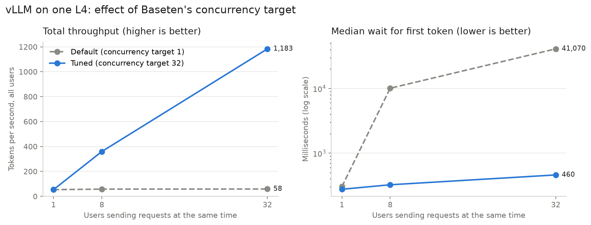
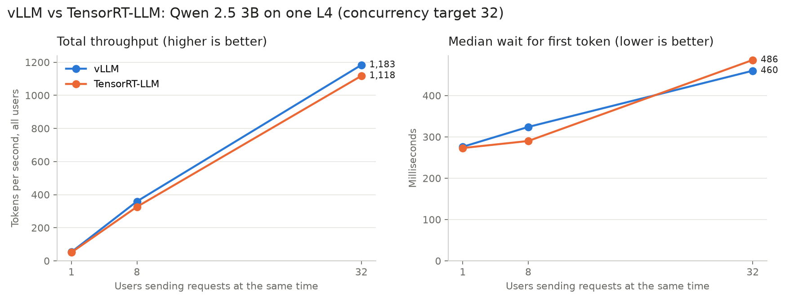

# LLMRuntimeBench

Benchmarking the same open-source LLM on the same GPU with two inference engines, **vLLM** and **TensorRT-LLM**, deployed on [Baseten](https://www.baseten.co).

The goal: answer the question a customer would ask before going to production. *Which setup should I run, and how fast and how expensive will it be?*

## TL;DR

1. **Configuration mattered far more than engine choice.** Raising Baseten's concurrency target from the default of 1 to 32 increased total throughput **~22x** and cut estimated cost per token from **~$4.41 to ~$0.20 per 1M tokens**, on the same GPU at the same hourly price.
2. **vLLM and TensorRT-LLM performed about the same** for this model and load: within ~5–10% of each other at every load level, which is likely within run-to-run noise.
3. **Both engines topped out at ~59 tokens/sec per user**, which points to a hardware limit on the L4 rather than an engine limit.





## Setup

| | |
|---|---|
| **Model** | [Qwen 2.5 3B Instruct](https://huggingface.co/Qwen/Qwen2.5-3B-Instruct), fp8, max context 8,192 |
| **GPU** | 1x NVIDIA L4 (24 GB) on Baseten, max replicas = 1 |
| **Engines** | TensorRT-LLM (Baseten Engine-Builder), vLLM (official Docker image) |
| **Prompt** | "Explain how a car engine works in one paragraph." (max 200 output tokens) |
| **Load levels** | 1, 8 and 32 users sending requests at the same time |
| **Client** | Async Python script run from California; latency includes network time |

Both engines used the same model, GPU, quantization (fp8) and context length so the comparison is fair.

## Results

### 1. The concurrency target (vLLM)

Baseten's default concurrency target is 1, meaning each replica is sent one request at a time. With that default, requests waited in line:

| Users | Median wait for first token | Total throughput (tok/s) |
|---|---|---|
| 1 | 303 ms | 53 |
| 8 | 10,104 ms | 58 |
| 32 | 41,070 ms (worst: 82,698 ms) | 58 |

After raising the concurrency target to 32, the GPU could batch requests together:

| Users | Median wait for first token | Per-user speed (tok/s) | Total throughput (tok/s) | Est. cost per 1M tokens |
|---|---|---|---|---|
| 1 | 276 ms | 59.3 | 53.5 | ~$4.41 |
| 8 | 324 ms | 58.4 | 359.2 | ~$0.66 |
| 32 | 460 ms | 52.6 | 1,183.3 | ~$0.20 |

Each user's speed dropped only ~11% from 1 to 32 users, while the GPU's total output grew 22x.

### 2. vLLM vs TensorRT-LLM (concurrency target 32)

| Users | Engine | Median wait for first token | Per-user speed (tok/s) | Total throughput (tok/s) | Est. cost per 1M tokens |
|---|---|---|---|---|---|
| 1 | vLLM | 276 ms | 59.3 | 53.5 | ~$4.41 |
| 1 | TRT-LLM | 273 ms | 58.9 | 51.0 | ~$4.63 |
| 8 | vLLM | 324 ms | 58.4 | 359.2 | ~$0.66 |
| 8 | TRT-LLM | 290 ms | 56.8 | 326.3 | ~$0.72 |
| 32 | vLLM | 460 ms | 52.6 | 1,183.3 | ~$0.20 |
| 32 | TRT-LLM | 486 ms | 54.8 | 1,117.5 | ~$0.21 |

Full notes, including single-request runs and a first inconclusive attempt, are in [`results/notes.md`](results/notes.md). Raw numbers are in [`results/results.csv`](results/results.csv).

## Recommendation

*(Write this section in your own words. Example direction below.)*

For a customer running a small model like Qwen 2.5 3B on an L4:

- **Check autoscaling before anything else.** The default concurrency target of 1 leaves most of the GPU unused. Set it to match the load the engine can batch.
- **Either engine is a reasonable choice at this size.** The difference was small enough that ease of setup can decide: vLLM deployed from a config file with no build step; TensorRT-LLM needed a 10–20 minute compile but is a managed Baseten engine.
- **For latency-sensitive apps (chat, voice),** both engines kept the median wait under 0.5 s at 32 concurrent users.
- **For throughput and cost (batch jobs),** keep the GPU busy: cost per token falls sharply as concurrency rises.

## Limitations

- Each load level was run once per configuration, so differences under ~10% may be noise.
- Output length varies between runs, which affects total time and throughput.
- Latency includes network time from the client to Baseten.
- Cost estimates assume ~$0.85/hr for an L4 and a GPU kept as busy as in the test.
- Tested only up to 32 concurrent users; engines may diverge at higher load.

## Repo layout

```
trtllm/config.yaml    TensorRT-LLM deployment config
vllm/config.yaml      vLLM deployment config
bench/test.py         Sends one request to check a deployment works
bench/single.py       Times one streaming request (TTFT, tokens/sec)
bench/load_test.py    Sends N requests at once and reports per-user and total metrics
bench/sweep.py        Runs several load levels with repeats and saves a CSV
bench/chart.py        Builds the charts in results/ from results/results.csv
results/              Notes, raw numbers and charts
```

## Reproduce

```bash
# Deploy (requires a Baseten account and API key)
uvx truss login
cd trtllm && uvx truss push
cd ../vllm && uvx truss push

# Run the benchmarks
cd ../bench
cp .env.example .env   # add your API key and model IDs
uv sync
uv run load_test.py vllm 32
uv run chart.py
```

---

Scripts were written with AI assistance (Claude). Deployments, testing, debugging and analysis by me.
